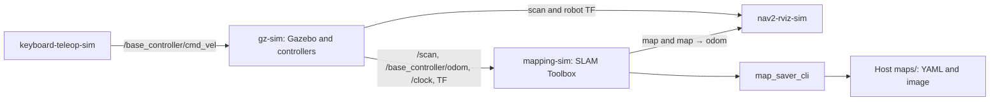
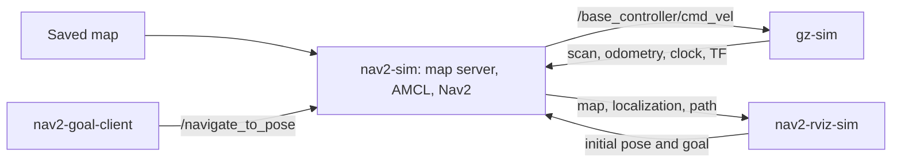
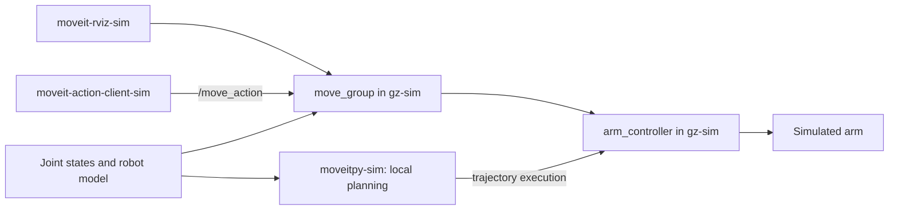
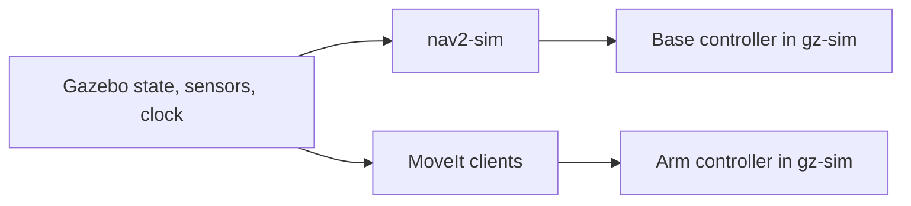
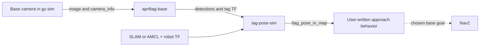
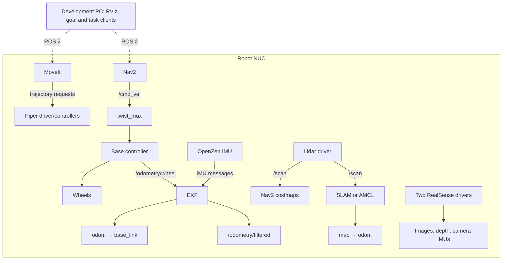
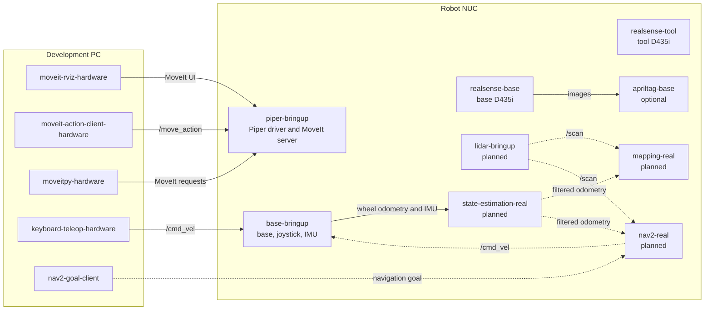

# System deployment architecture

The diagrams below describe the existing simulation services. Hardware deployment is still incomplete; its proposed layout is marked separately below. See [Compose services](compose_services.md) for the service catalog and [Startup and walkthrough](../../startup/index.md) for commands.

## Simulation: mapping

SLAM supplies `map → odom`; the simulated controller supplies `odom → base_link`. Manual driving provides the views needed to build the map. See [mapping](../../startup/mapping.md).

## Simulation: navigation

AMCL replaces SLAM as the `map → odom` publisher. Stop mapping and keyboard driving before Nav2 drives. See [navigation](../../startup/navigation.md).

## Simulation: arm control

The C++ client delegates planning to `move_group`; MoveItPy plans in its own process. See [MoveIt APIs](../moveit.md).

## Simulation: arm control and navigation

One `gz-sim` backend supplies the arm and base controllers. Add the navigation services for base goals and the MoveIt clients for arm goals. The stacks do not provide coordinated mobile-manipulator planning: the Nav2 footprint is fixed and assumes the initial arm pose. An extended arm needs a reviewed footprint and clearance checks. See [Nav2 configuration](../navigation.md).

## Optional AprilTag detection

The detector and pose tool exist. Selecting a reachable approach pose and implementing the approach behavior is the exercise; the project does not automatically drive to a detected tag. See [AprilTags](../apriltags.md).

## Proposed real robot architecture

This diagram shows the intended roles of a development PC and the robot NUC.
The real robot navigation and localization components shown here are planned.

## Deployment by host

`mapping-real` and `nav2-real` are planned alternatives for different phases; run one at a time.

**`mapping-real`** would run SLAM Toolbox on the NUC. It would use lidar scans
and the EKF's odometry to build a map, publish `map → odom`, and save the map
for later use. The robot would be driven manually during mapping.

**`nav2-real`** would load that saved map and run AMCL plus Nav2's planning and
driving components. AMCL would use the map and lidar scans to localize the
robot. After an initial pose is set, Nav2 could accept goals and send
`/cmd_vel` through the base's `twist_mux`. The lidar driver and EKF would keep
running in both phases.

## Hardware command routing

`keyboard-teleop-hardware` publishes `/cmd_vel` through the base command multiplexer. Simulation teleoperation instead publishes stamped commands directly to `/base_controller/cmd_vel`. Hardware arm control uses the [Piper driver path](../moveit.md#hardware-command-path).
