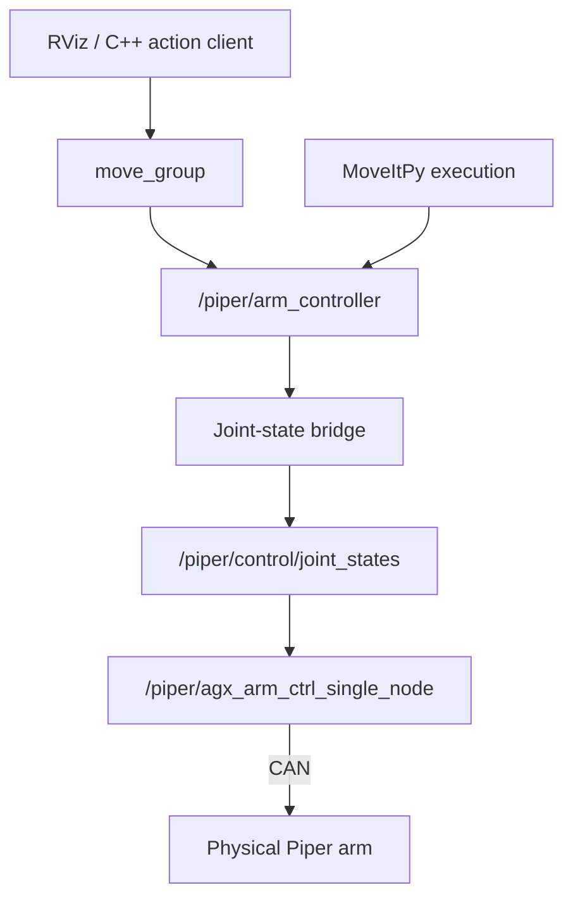

# MoveIt APIs and arm control

MoveIt plans arm trajectories; Nav2 controls the mobile base. The examples live in `curtmini_piper_tools`, while robot configuration and bringup live in `curtmini_piper`.

## Interfaces in this project

| Package | Command | Role |
| --- | --- | --- |
| `curtmini_piper_moveitpy_example` | `moveit_goal` | Plans in a Python process with MoveItPy; optionally executes through the selected trajectory controller |
| `curtmini_piper_moveit_action_client_example` | `moveit_action_client_example` | Sends a joint goal to the running `/move_action` server |
| `curtmini_piper_tag_tools` | `tag_pose_in_map` | Transforms fresh observed tag poses into `map`; see [AprilTags](apriltags.md) |
| `curtmini_piper_nav_examples` | `nav_to_pose` | Sends a mobile-base navigation goal; see [navigation](navigation.md) |

The tools repository has its own Sphinx API documentation. This page describes how the examples connect to this robot.

## MoveItPy

`curtmini_piper_moveitpy_example/curtmini_piper_moveitpy_example/moveit_goal.py` creates a `MoveItPy` instance with the robot model and planning configuration, then:

1. Gets the `arm` planning component with `get_planning_component("arm")`.
2. Uses `set_start_state_to_current_state()` and sets a joint or TCP goal.
3. Calls `plan()` with `PlanRequestParameters`.
4. If execution was requested, calls `execute()` with the selected controller.

Planning happens inside the Python process. This example does not send its planning request to `/move_action`. It still needs current joint states and a running trajectory controller to execute.
The Compose wrapper waits for `/joint_states` before starting it.

### Goal parameters

Edit `curtmini_piper_moveitpy_example/config/goal.yaml` in the tools checkout. Compose mounts this directory into the client, so goal edits apply to the next run without rebuilding.

| Parameter | Meaning |
| --- | --- |
| `goal_type: joints` | Six `joint_positions` in radians, ordered `piper_joint1` through `piper_joint6` |
| `goal_type: pose` | `pose_position` in metres and `pose_orientation` quaternion `[x, y, z, w]`; target TCP pose in `piper_base_link` |
| `goal_type: relative_pose` | Nonzero `relative_position` translation in metres along the current TCP's local axes; preserves its orientation |
| `controller_mode` | `simulation` selects `arm_controller`; `hardware` selects `piper/arm_controller` |
| `plan_only` | Defaults to true; false requests trajectory execution |
| `use_sim_time` | True for Gazebo, false for hardware |
| `planning_pipeline`, `planner_id` | Defaults are `ompl` and `RRTConnect` |
| `planning_time`, `planning_attempts` | Defaults are 5 seconds and one attempt |
| `velocity_scaling`, `acceleration_scaling` | Defaults are 0.1; accepted values are greater than zero and at most one |

The relative TCP goal is transformed into `base_link` using the current robot state. It is a pose target, not a guarantee of a straight Cartesian path.
The code logs `Execution command finished` after `execute()` returns; that log alone is not a measurement of physical goal accuracy.

See [MoveItPy walkthrough](../startup/moveitpy.md) for commands.

## C++ action client

`curtmini_piper_moveit_action_client_example/src/moveit_action_client_example.cpp` creates an `rclcpp_action` client for `moveit_msgs/action/MoveGroup` at `/move_action`.
It sends six joint constraints for planning group `arm`. The running `move_group` handles planning and optional execution.

The default Compose services run this joint-goal executable with `config/goal.yaml`. The package also contains separate pose and relative-TCP examples; the default service does not select them. See their source files when extending the example.

The request uses the current state, the configured pipeline/planner, five seconds of planning time, and velocity/acceleration scaling of 0.1. Success requires both a successful action result and MoveIt's success error code.

See [C++ walkthrough](../startup/moveit_cpp.md) for commands.

## Planning versus execution

`MOVEIT_PLAN_ONLY=true` is the Compose default for both clients. A command prefix overrides `.env` for that invocation. `MOVEIT_PLAN_ONLY=false` requests execution, including on real hardware.
Compose supplies `controller_mode` and `use_sim_time` for the Python client and `use_sim_time` for the C++ client. Keep model geometry, ROS domain and middleware consistent with the backend.

RViz is a separate client of the running MoveIt backend. Simulation startup already launches it; see [standalone RViz](../startup/rviz.md) when another window is needed.

## Hardware command path

The Piper bringup publishes the complete robot description. When starting the base alongside it, `PUBLISH_BASE_DESCRIPTION=False` prevents a second, base-only model publisher. For the base alone, enable its publisher.

The current arm integration uses a fake-backed trajectory controller, a joint-state bridge, and the physical CAN driver:

Controller completion reflects the fake-backed trajectory state; it is not independent confirmation that the physical arm reached its target.

### `control_enabled`

The default `control_enabled=true` leaves the driver's command gate enabled continuously.
With `control_enabled:=false`, bringup launches `piper_control_gate`, which enables the driver during an active trajectory and disables it afterward. This setting is not a permanent command lock.

### `fast_mode`

The driver's joint-state callback uses `move_js` to stream joint setpoints when `fast_mode=true`, and `move_j` when false. The project Compose service defaults to true. This selects how commands are sent to the arm; it does not change the planning interface.

For CAN setup and launch commands, see [real hardware](../startup/real_hardware.md).
