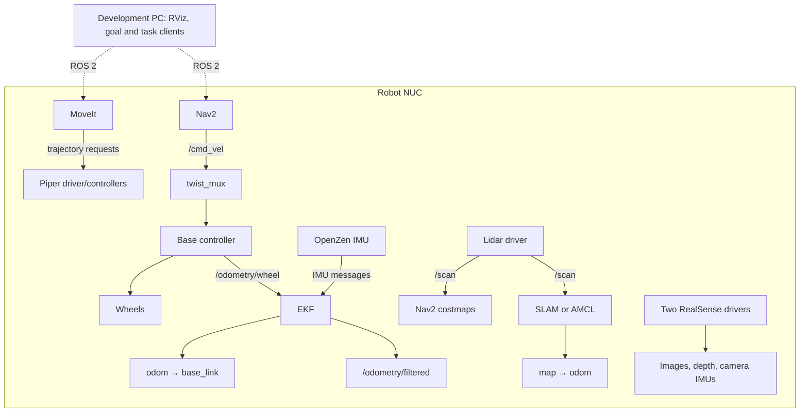
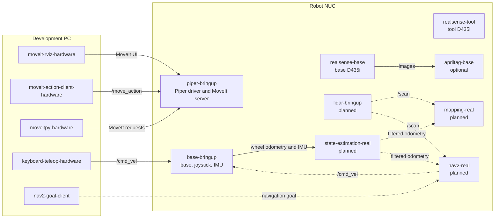

# Overview

This project integrates a Curt Mini mobile base, an AgileX Piper arm, MoveIt 2,
and Gazebo Harmonic. It supports source-based development and Docker Compose
workflows.

The main repositories are:

- [Curt Mini](https://github.com/ipa-may/curt_mini): base description,
  teleoperation, hardware bringup, and ROS 2 control integration.
- [Curt Mini Piper](https://github.com/ipa-may/curtmini_piper): combined robot
  description, MoveIt configuration, hardware bringup, camera launches,
  motion examples, and their Docker builds.
- [Gazebo simulation](https://github.com/ipa-may/curtmini_piper_gz_sim):
  simulation launch, controllers, sensors, worlds, and the Gazebo Docker build.
- [Containers](https://github.com/ipa-may/curtmini_piper_containers): Compose
  includes, shared middleware configuration, and workspace tooling.

The combined model prefixes Piper links and joints with `piper_`. Set the arm,
TCP, lidar, and simulated camera mounts in
`curtmini_piper_description/config/geometry.yaml`. Set measured physical camera
mounts in `curtmini_piper_sensors/config/camera_mounts.yaml`; see the
[camera guide](startup/cameras.md).
The simulation's starting base pose and six arm joint positions are separate
settings in `curtmini_piper_gz_sim/config/initial_state.yaml`.

## Proposed real robot architecture

This diagram shows the intended roles of a development PC and the robot NUC.
The real robot navigation and localization components shown here are planned.

## Deployment by host

`mapping-real` and `nav2-real` are planned alternatives for different phases; run one at a time.

**`mapping-real`** would run SLAM Toolbox on the NUC. It would use lidar scans
and the EKF's odometry to build a map, publish `map → odom`, and save the map
for later use. The robot would be driven manually during mapping.

**`nav2-real`** would load that saved map and run AMCL plus Nav2's planning and
driving components. AMCL would use the map and lidar scans to localize the
robot. After an initial pose is set, Nav2 could accept goals and send
`/cmd_vel` through the base's `twist_mux`. The lidar driver and EKF would keep
running in both phases.
